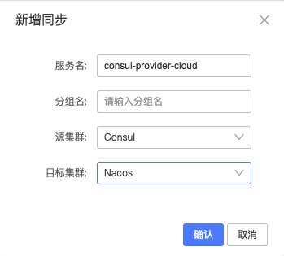
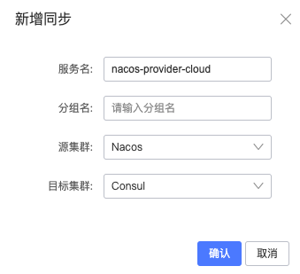

# Consul ↔ Nacos 双向同步

本例演示 Spring Cloud 应用在 Consul 和 Nacos 之间双向同步：

1. Consul 同步到 Nacos：`consul-provider-cloud` 注册在 Consul，同步到 Nacos 后，Nacos 上的应用可以调用它。
2. Nacos 同步到 Consul：`nacos-provider-cloud` 注册在 Nacos，同步到 Consul 后，Consul 上的应用可以调用它。

| 模块 | 注册到 | 端口 | 接口 |
|---|---|---|---|
| consul-provider-cloud | Consul，服务名 `consul-provider-cloud` | 18089 | `/hello` 返回 `Hello World from Consul!`；`/nacos-hello` 通过 Consul 调用 `nacos-provider-cloud` |
| nacos-provider-cloud | Nacos，服务名 `nacos-provider-cloud` | 18088 | `/hello` 返回 `Hello World from Nacos!`；`/consul-hello` 通过 Nacos 调用 `consul-provider-cloud` |

## 1. 准备环境

按[公共环境准备](../README.MD#公共环境准备)启动 MySQL、Nacos 和 nacos-sync，再启动一个 Consul。示例配置连接的是本机的 8900 端口：

```shell
docker run -d --name consul -p 8900:8500 hashicorp/consul:1.20 agent -dev -client=0.0.0.0
```

Consul 控制台在 http://127.0.0.1:8900/ui 。然后在仓库根目录执行 `mvn clean package`。

## 2. 启动应用

```shell
java -jar cloud-consul/consul-provider-cloud/target/consul-provider-cloud-1.0-SNAPSHOT.jar
SPRING_CLOUD_NACOS_DISCOVERY_USERNAME=nacos SPRING_CLOUD_NACOS_DISCOVERY_PASSWORD=<nacos 密码> \
  java -jar cloud-consul/nacos-provider-cloud/target/nacos-provider-cloud-1.0-SNAPSHOT.jar
```

Nacos 没有开启鉴权时，去掉 `nacos-provider-cloud` 前面的两个环境变量即可。

## 3. 在 nacos-sync 里添加集群

打开 http://127.0.0.1:8083 ，在「集群配置 → 新增集群」里添加：

| 集群类型 | 集群 IP 列表 |
|---|---|
| CONSUL | `127.0.0.1:8900` |
| NACOS | `127.0.0.1:8848`，开启鉴权时填写用户名和密码 |

## 4. 添加同步任务

在「服务同步 → 新增同步」里添加两个任务，分组名留空即为 `DEFAULT_GROUP`：

| 源集群 | 目标集群 | 服务名 |
|---|---|---|
| Consul | Nacos | `consul-provider-cloud` |
| Nacos | Consul | `nacos-provider-cloud` |





## 5. 验证

```shell
curl http://127.0.0.1:18088/consul-hello   # Nacos 上的应用调用 Consul 上的服务，返回 Hello World from Consul!
curl http://127.0.0.1:18089/nacos-hello    # Consul 上的应用调用 Nacos 上的服务，返回 Hello World from Nacos!
```

Spring Cloud 客户端会缓存服务列表，同步后可能要等半分钟到一分钟才能调通。也可以在 Nacos 控制台的服务列表和 Consul
控制台里看到同步过去的服务。

## 同步规则

- Consul 源每 3 s 轮询一次。只有健康检查通过的实例会同步到 Nacos。
- Nacos 到 Consul 只注销已经下线的实例，同一服务里其他健康的实例不受影响。
- 两个方向的任务同时存在时不会回环：同步过去的副本带有来源集群的元数据，不会再被同步回来。
- 删除任务时，会移除它同步到目标端的副本，目标端原生注册的实例不受影响。
