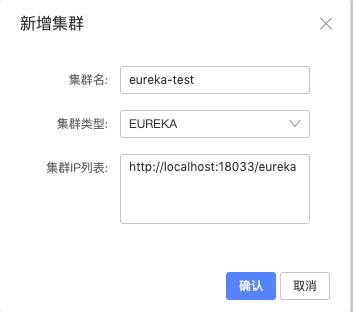
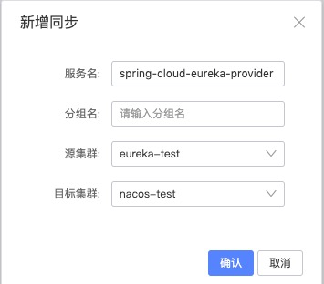

# Eureka ↔ Nacos 双向同步

本例演示 Spring Cloud 应用在 Eureka 和 Nacos 之间双向同步：

1. Eureka 同步到 Nacos：`eureka-provider` 注册在 Eureka，同步到 Nacos 后，Nacos 上的应用可以调用它。
2. Nacos 同步到 Eureka：`nacos-cloud-consumer` 注册在 Nacos，同步到 Eureka 后，Eureka 上的应用可以调用它。

| 模块 | 注册到 | 端口 | 接口 |
|---|---|---|---|
| eureka-server | — | 18033 | Eureka 服务端，地址 `http://127.0.0.1:18033/eureka` |
| eureka-provider | Eureka，服务名 `spring-cloud-eureka-provider` | 18032 | `/hello` 返回 `Hello World from Eureka!`；`/hello-nacos` 通过 Eureka 调用 `spring-cloud-nacos-consumer` |
| nacos-cloud-consumer | Nacos，服务名 `spring-cloud-nacos-consumer` | 18035（管理端口 32002） | `/hello` 返回 `Hello World from Nacos!`；`/hello-eureka` 通过 Nacos 调用 `spring-cloud-eureka-provider` |

## 1. 准备环境

按[公共环境准备](../README.MD#公共环境准备)启动 MySQL、Nacos 和 nacos-sync，然后在仓库根目录执行 `mvn clean package`。

## 2. 启动应用

```shell
java -jar cloud-eureka/eureka-server/target/eureka-server-1.0-SNAPSHOT.jar
java -jar cloud-eureka/eureka-provider/target/eureka-provider-1.0-SNAPSHOT.jar
SPRING_CLOUD_NACOS_DISCOVERY_USERNAME=nacos SPRING_CLOUD_NACOS_DISCOVERY_PASSWORD=<nacos 密码> \
  java -jar cloud-eureka/nacos-cloud-consumer/target/nacos-cloud-consumer-1.0-SNAPSHOT.jar
```

Nacos 没有开启鉴权时，去掉 `nacos-cloud-consumer` 前面的两个环境变量即可。

## 3. 在 nacos-sync 里添加集群

打开 http://127.0.0.1:8083 ，在「集群配置 → 新增集群」里添加：

| 集群类型 | 集群 IP 列表 |
|---|---|
| EUREKA | `http://127.0.0.1:18033/eureka` |
| NACOS | `127.0.0.1:8848`，开启鉴权时填写用户名和密码 |



## 4. 添加同步任务

在「服务同步 → 新增同步」里添加两个任务，分组名留空即为 `DEFAULT_GROUP`：

| 源集群 | 目标集群 | 服务名 |
|---|---|---|
| Eureka | Nacos | `spring-cloud-eureka-provider` |
| Nacos | Eureka | `spring-cloud-nacos-consumer` |



## 5. 验证

```shell
curl http://127.0.0.1:18035/hello-eureka   # Nacos 上的应用调用 Eureka 上的服务，返回 Hello World from Eureka!
curl http://127.0.0.1:18032/hello-nacos    # Eureka 上的应用调用 Nacos 上的服务，返回 Hello World from Nacos!
```

Eureka 服务端有 30 s 的响应缓存，Spring Cloud 客户端也每 30 s 刷新一次本地缓存，所以同步后可能要等一分钟左右才能调通。在 Nacos
控制台的服务列表里也能看到同步过来的 `spring-cloud-eureka-provider`，它的元数据里带有 `sourceClusterId`。

## 同步规则

- Eureka 到 Nacos 只同步状态为 UP 的实例。把实例设为 OUT_OF_SERVICE 或 DOWN 后，它会从 Nacos 移除，恢复 UP 后会重新同步。
- Nacos 到 Eureka 不同步不健康或已禁用的实例。
- 两个方向的任务同时存在时不会回环：同步过去的副本带有来源集群的元数据，不会再被同步回来。
- 删除任务时，会移除它同步到目标端的副本，目标端原生注册的实例不受影响。
- Eureka 上的应用被强制杀掉（kill -9）时不会主动注销，要等 Eureka 剔除过期租约后才会从 Nacos 移除，实测约 3 到 4 分钟。

## 用其他 Spring Cloud 版本系列构建 Eureka

Eureka 服务端和 `eureka-provider` 可以用 Spring Cloud 2021.0 到 2025.0 的任一版本系列构建，nacos-sync 2.x 都已验证过：

```shell
mvn package -pl cloud-eureka/eureka-server,cloud-eureka/eureka-provider -am \
  -Dspring-boot.version=<Spring Boot 版本> -Dspring-cloud.version=<Spring Cloud 版本>
```

| Spring Cloud | Spring Boot |
|---|---|
| 2021.0.9 | 2.7.18 |
| 2022.0.5 | 3.0.13 |
| 2023.0.6 | 3.3.13 |
| 2024.0.3 | 3.4.13 |
| 2025.0.3 | 3.5.16 |
