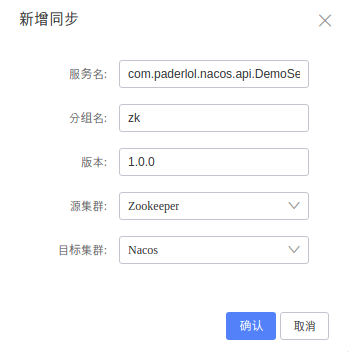
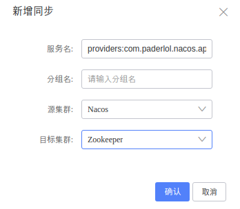

# ZooKeeper ↔ Nacos 双向同步（Dubbo）

本例演示 Dubbo 3 服务在 ZooKeeper 和 Nacos 之间双向同步。两边各有一个 `com.paderlol.nacos.api.DemoService` 的提供者，
用版本 `1.0.0` 和不同的分组区分：

1. ZooKeeper 同步到 Nacos：`zookeeper-provider` 注册在 ZooKeeper（分组 `zk`），同步到 Nacos 后，`nacos-consumer` 通过 Nacos 调用它。
2. Nacos 同步到 ZooKeeper：`nacos-provider` 注册在 Nacos（分组 `nacos`），同步到 ZooKeeper 后，`zookeeper-consumer` 通过 ZooKeeper
   调用它。

| 模块 | 注册中心 | 端口 | 作用 |
|---|---|---|---|
| zookeeper-provider | ZooKeeper | Dubbo 端口自动分配 | 提供分组 `zk` 的 `DemoService`，返回 `[zookeeper-provider] : Hello, ...` |
| nacos-provider | Nacos | Dubbo 端口自动分配 | 提供分组 `nacos` 的 `DemoService`，返回 `[nacos-provider] : Hello, ...` |
| nacos-consumer | Nacos | 18080 | `/sayHello` 通过 Nacos 调用分组 `zk` 的 `DemoService` |
| zookeeper-consumer | ZooKeeper | 18081 | `/sayHello` 通过 ZooKeeper 调用分组 `nacos` 的 `DemoService` |

## 1. 准备环境

按[公共环境准备](../README.MD#公共环境准备)启动 MySQL、Nacos 和 nacos-sync，再启动一个 ZooKeeper：

```shell
docker run -d --name zookeeper -p 2181:2181 zookeeper:3.7.2
```

然后在仓库根目录执行 `mvn clean package`。

## 2. 启动应用

示例配置默认连接 `127.0.0.1:2181,2182,2183` 的三节点 ZooKeeper 和不开鉴权的 Nacos，并且两个 consumer 的 QoS 端口相同（22224），
同时启动会冲突。下面用 `SPRING_APPLICATION_JSON` 改成单节点 ZooKeeper、开启鉴权的 Nacos，并关闭 QoS：

```shell
ZK='{"dubbo":{"registry":{"address":"zookeeper://127.0.0.1:2181"},"metadata-report":{"address":"zookeeper://127.0.0.1:2181"},"application":{"qos-enable":false}}}'
NACOS_URL='nacos://127.0.0.1:8848?username=nacos&password=<nacos 密码>'
NACOS="{\"dubbo\":{\"registry\":{\"address\":\"$NACOS_URL\"},\"metadata-report\":{\"address\":\"$NACOS_URL\"},\"application\":{\"qos-enable\":false}}}"

SPRING_APPLICATION_JSON="$ZK"    java -jar dubbo-zookeeper/zookeeper-provider/target/zookeeper-provider-1.0-SNAPSHOT.jar
SPRING_APPLICATION_JSON="$NACOS" java -jar dubbo-zookeeper/nacos-provider/target/nacos-provider-1.0-SNAPSHOT.jar
```

Nacos 没有开启鉴权时，把 `NACOS_URL` 改成 `nacos://127.0.0.1:8848` 即可。

## 3. 在 nacos-sync 里添加集群

打开 http://127.0.0.1:8083 ，在「集群配置 → 新增集群」里添加：

| 集群类型 | 集群 IP 列表 |
|---|---|
| ZK | `127.0.0.1:2181` |
| NACOS | `127.0.0.1:8848`，开启鉴权时填写用户名和密码 |

## 4. 添加同步任务

在「服务同步 → 新增同步」里添加：

| 源集群 | 目标集群 | 服务名 | 分组名 | 版本 |
|---|---|---|---|---|
| ZooKeeper | Nacos | `com.paderlol.nacos.api.DemoService` | `zk` | `1.0.0` |
| Nacos | ZooKeeper | `providers:com.paderlol.nacos.api.DemoService:1.0.0:nacos` | 留空 | — |

ZooKeeper 到 Nacos 的任务填写接口名，再用分组和版本选出要同步的提供者：



Nacos 到 ZooKeeper 的任务填写 Dubbo 在 Nacos 里注册的服务名，它已经包含了版本和分组，所以分组名留空。服务名可以在 Nacos 控制台的
服务列表里复制：



## 5. 验证

启动两个 consumer：

```shell
SPRING_APPLICATION_JSON="$NACOS" java -jar dubbo-zookeeper/nacos-consumer/target/nacos-consumer-1.0-SNAPSHOT.jar
SPRING_APPLICATION_JSON="$ZK"    java -jar dubbo-zookeeper/zookeeper-consumer/target/zookeeper-consumer-1.0-SNAPSHOT.jar
```

再调用：

```shell
curl http://127.0.0.1:18080/sayHello   # [zookeeper-provider] : Hello, This is from Zookeeper to Nacos Sync !
curl http://127.0.0.1:18081/sayHello   # [nacos-provider] : Hello, This is from Nacos to Zookeeper Sync !
```

请在第 4 步的任务生效、提供者已经出现在对端注册中心之后再启动 consumer：Dubbo 默认会在启动时检查提供者是否存在，提供者还没同步过去时 consumer 可能启动失败。

## 同步规则

- ZooKeeper 到 Nacos 会同步同一接口下所有匹配分组和版本的提供者；某个提供者下线后，它会从 Nacos 移除，其他提供者保留。
- Nacos 到 ZooKeeper 的任务创建后会立即写入 ZooKeeper，删除任务后重新创建也一样。
- 两个方向的任务同时存在时不会回环：同步过去的提供者带有来源集群的信息，不会再被同步回来。
- 删除任务时，会移除它同步到目标端的提供者，目标端原生注册的提供者不受影响。
- ZooKeeper 到 Nacos 的任务服务名填 `*` 时，会全量同步 ZooKeeper 里所有 Dubbo 服务。
